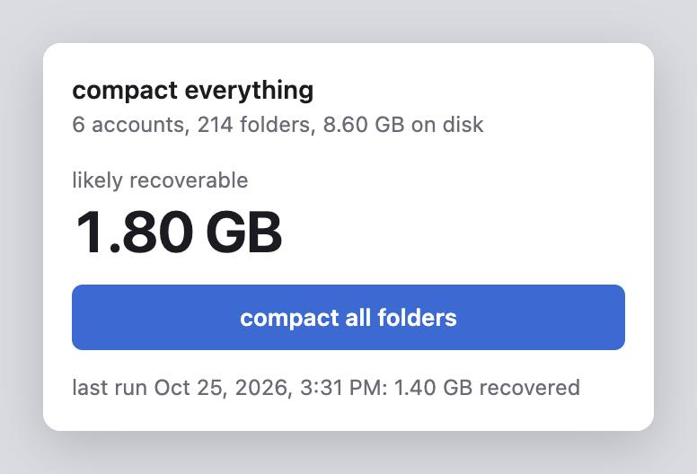
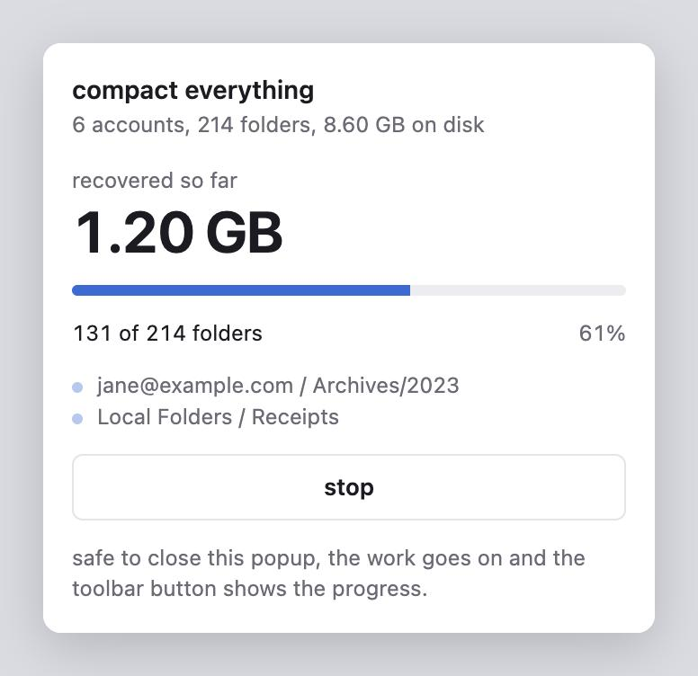
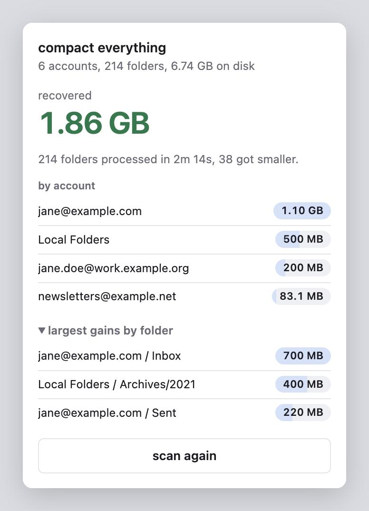

# Compact Everything

*a Thunderbird add-on that compacts every folder in every account in one go, shows the progress while it works, and tells you how much disk space came back*

[](https://github.com/stefangabos/compact-everything/blob/master/LICENSE.md)

When you delete or move messages, Thunderbird does not remove them from disk right away, it only marks them as deleted. Compacting rewrites these folders without those messages and gives the space back. Thunderbird offers the compacting options but only for one folder or one account at a time, and shows the saved space in the status bar only for a very short time so you might miss it. With many accounts and folders that gets tedious, and the result is easy to miss.

**Compact Everything** adds a button to the toolbar - click it, see how much space is likely recoverable, compact everything with one more click, and get the real numbers at the end.

## Features

- compacts every folder of every account with one click: local folders, POP accounts, RSS feeds and the offline copies of IMAP folders
- shows an estimate of the recoverable space before you start
- shows live progress: folders done, space recovered so far, and the folders being worked on right now
- reports the real result, measured on disk: total space recovered, a breakdown by account, the folders that shrank the most, and any folder that could not be compacted, with the reason
- keeps working when the popup is closed, with the progress shown as a percentage on the toolbar button
- remembers the result of the last run
- has a settings page behind the gear icon, to show only the icon on the toolbar button, see the version number and the release notes, and open this page

## Screenshots

<p align="center">
    
    
    
</p>

## How it works

The add-on runs the same compact routine Thunderbird uses for its own "compact" command, one folder at a time per account and up to three accounts in parallel. The space recovered is measured on disk, from the size of each folder's mailbox file and `.msf` index before and after compacting.

The estimate shown before starting comes from Thunderbird's own count of bytes taken by deleted messages, capped at the size of each folder's mailbox file. IMAP folders that are not set for offline use keep no messages on disk, so they do not count towards the estimate.

Compacting an IMAP folder also expunges it on the server, which permanently removes messages marked as deleted. This is the same as Thunderbird's own compact command.

>   At the time of writing, compacting folders from an add-on is only possible through an [experiment API](https://developer.thunderbird.net/add-ons/mailextensions/experiments), and because of that the add-on is not available on addons.thunderbird.net - see below.

## Why it is not on addons.thunderbird.net

Thunderbird's extension API can list folders, move messages and much more, but it cannot compact a folder, nor does it tell how much space a folder takes on disk. The only way for an add-on to do that is through an [experiment API](https://developer.thunderbird.net/add-ons/mailextensions/experiments): privileged code that talks to Thunderbird's internals directly. **Compact Everything** uses one, and through it calls the same compact routine Thunderbird itself uses.

Because experiment APIs have that much access, add-ons using them get a full manual review on addons.thunderbird.net. In March 2026 the Thunderbird add-ons team [paused the review of new add-ons that use experiment APIs](https://thunderbird.topicbox.com/groups/addons/T6ff545fb6d479da5/temporary-pause-on-new-experiment-api-add-on-reviews) because of limited review capacity, and in June 2026 extended the pause until at least the next Thunderbird ESR release, in 2027. Add-ons that were already listed can still publish updates, but new ones cannot get in.

**Compact Everything** was submitted in November 2026 and was turned down for exactly that reason - not because of a problem with the add-on, but because new experiment add-ons are not being accepted at the moment. The only experiments allowed are unmodified copies of the [official API drafts](https://github.com/thunderbird/webext-experiments), and none of them can compact folders.

So it lives here instead. Thunderbird does not require add-ons to be signed, so the release installs from file, and it keeps itself up to date from this repository. If Thunderbird adds folder compacting to its extension API, or the pause is lifted, it can move to addons.thunderbird.net.

## Requirements

Thunderbird 128 or newer. Tested on Thunderbird 140 ESR and Thunderbird 160.

## Installation

Download the `.xpi` file from the [releases page](https://github.com/stefangabos/compact-everything/releases) and, in Thunderbird, go to *Add-ons and Themes*, click the gear icon and choose *Install Add-on From File*.

Once installed, the add-on updates itself from this repository, the same way add-ons installed from addons.thunderbird.net do.

## Building

```bash
./build.sh
```

Packages the `extension` folder into `compact-everything.xpi`.

## Privacy

The add-on does not collect, send or share any data. It reads folder information and file sizes on your computer, and keeps the result of the last run in the add-on's local storage. Thunderbird itself checks this repository for new versions of the add-on about once a day, so GitHub sees the IP address of each installation when it does.

## License

[MIT](LICENSE.md)
